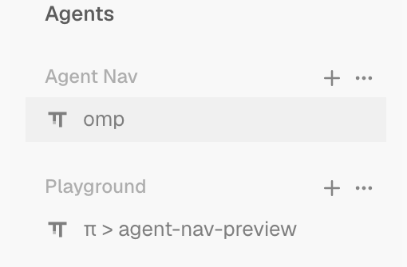

# Tern Agent Navigations

A compact navigator panel for [Tern](https://stencil.so/tern) showing agents grouped by **Tern Session → Agent Session**. Each agent is represented by a single row featuring its harness logo and session title, clickable to focus.


## Usage

- **Ctrl+Alt+N** or command palette `Agent Nav: Toggle`: Open or close the navigator panel.
- Command palette `Agent Nav: Toggle left / right`: Toggle panel attachment between the left and right window edge.
- Command palette `Agent Nav: Reset Width`: Reset panel width to the default ratio (20% of the active tab width).
- Click any agent row: Immediately switches to that agent's Tern session and focuses its pane.
- Each session header has **+** to start omp and **…** to choose a harness. The menu's **Open in new tab** switch selects a new tab or a right split in that session's current tab.

## Behavior & Design

- **Single panel per window, follows active tab**: The window keeps one canvas and moves it to the active tab as a full-height rail. Content pane IDs and the split hierarchy are retained. Saved divider ratios are fitted through Tern's fractional-cell resize operations.
- **Proportional fixed width**: Dragging the divider updates the remembered share ratio (`agent_nav.share`), which travels across tabs and scales smoothly with window resizing. Intermediate widths produced while rebuilding a multi-block tab are never saved as manual divider adjustments.
- **Titles and harness**: each row shows the agent's pane title (omp, Codex and Copilot write their session title there). The harness logo comes from the pane's foreground program, so Codex and Copilot are recognised even when their title does not name them.
- **Harness menu**: OMP comes first, followed by Tern's built-in Claude Code, Codex, and GitHub Copilot registrations and your `agents.custom` entries. Known names use their harness icon. Other names use a first-character avatar. The menu opens over the rows without moving them.
- **Enable Tern UI**: controls how agents launched by the menu and `+` run. When enabled, omp uses Tern's native frontend and other agents open through `tern acp`. Local launches retain the window's Tern configuration and daemon context. When disabled, omp and the built-in CLIs use their terminal interfaces. Tern's custom ACP configuration does not provide a native TUI command, so custom entries are unavailable while this switch is off. The preference defaults to enabled and persists across reloads.
- **Open in new tab**: enabled by default. On opens a new tab in the clicked Tern session; off opens a block to the right of content in that session's current tab. The navigator is never split, and the new block takes focus. Both `+` and harness picks use this preference, independently of **Enable Tern UI**. The choice persists across reloads. Changing either switch keeps the menu open; the `+` tooltip follows the selected position.
- **Row states**: running uses amber text shimmer, finished and unread is green, and error is semibold red. These semantic hues stay consistent across color themes, with separate light/dark values for readability. Waiting for input uses the theme's purple, and read rows use secondary text. Only the focused agent row has a fixed faint neutral background; status, hover, and press never add colored backgrounds. Tern session names are shown as written, fainter than agent titles.
- **State sources and precedence**: authoritative agent-block state (omp and wrapped chat agents) is trusted when it reports working or waiting_input; an idle/exited report is cross-checked against the pane title's spinner frames (leading or trailing braille), the busy/prompt pair, and the pane's last eight visible screen rows before it is accepted. A stale report (ACP-wrapped panes have reported idle through a real turn) therefore cannot mask real activity. Matching uses the observed English UI text of Copilot, Codex and Claude Code; when those agents change their interfaces the hint tables in `window.luau` need updating.
- **Hook budget**: Screen reads are cached per pane and staggered, with at most two fresh reads per render. Layout restoration runs in bounded batches across ticks. Tern pauses a hook that exceeds its 50 ms Lua budget and retries it with increasing backoff; repeated overruns can leave the panel stale during that pause.
- **Safe lifecycle**: Explicitly closing the panel disables the feature; if the containing tab or session is closed, the panel automatically restores in the remaining active tab.
- **Reload recovery**: An unfinished rearrangement resumes after plugin reload in the same window. The controller records responsibility before parking a content pane and keeps that responsibility until the pane has returned. Recovery across the loss or replacement of a native window is limited by Tern's window lifecycle APIs.
- Persisted configuration keys: `agent_nav.enabled`, `agent_nav.side`, `agent_nav.share`, `agent_nav.launch_ui`, `agent_nav.open_in_tab`.

Focused agent row, with a fixed neutral background:



## Known Limitations

- **Dropdown host limitation**: the current menu is confined to the navigator canvas. Clicking outside it within the rail, focusing another pane, or selecting an item closes it. Tern 0.9.8 exposes no window-level popup API to canvas plugins, filters native HTML popover attributes, and reserves Escape in its preset. The requested global dropdown and Escape dismissal remain blocked on host support. This implementation does not claim those behaviors.
- **Divider precision**: Native minimum pane sizes can prevent an exact saved ratio in small nested panes.
- **Older Tern builds** ([stencil-hq/tern-sdk#30](https://github.com/stencil-hq/tern-sdk/issues/30)): before the fix in Tern 0.9.7, every `tern` CLI attach spent a step of the daemon-wide id counter, so a daemon that had served thousands of them handed window plugins truncated tab ids. On such a build the panel cannot move into the newer tabs and shows an explicit error instead; status display keeps working. Tern 0.9.7 no longer advances the counter on read-only CLI attaches.
- **Screen-hint matching**: status detection for terminal agents matches the observed English UI text of Copilot, Codex and Claude Code (see the hint tables in `window.luau`). A localized or reworded agent interface can hide a running or waiting state until the hints are updated.
- A Copilot pane whose monthly quota is exhausted shows as a plain finished row; it is not misreported as running.

## Development

- `tests/smoke.py`: blackbox regression against a running Tern window. Fixture agents run a generated local wire client that completes the TSP composer handshake, emits progress and screen output, and exits with a chosen status. It never invokes a model. Run the state and native-close subset with `python3 tests/smoke.py --existing-window --only test_native_tsp_five_state_fixture,test_manual_close_disables --artifacts /tmp/tern-nav-native-fixture`.
- `tests/width_regression.py`: native regression for four- and eight-block tab switches, both rail sides, content ratios, focus changes during restoration, default width memory and manual divider adjustments. Run in an isolated visible GUI sandbox with `python3 tests/width_regression.py --control /tmp/navw.sock --config /tmp/navw/config --daemon /tmp/navw/daemon.sock` after installing the plugin there. Cell comparisons require rendered terminal dimensions; the initial 80x24 grid is not evidence of rendering.
  Give the eight-block fixture enough space for native minimum pane sizes; a 1780×940 viewport was exercised. Keep the half-cell accuracy threshold unchanged.
- `.agents/skills/verify-tern-agent-nav/`: live verification harness and the feature map under `features/`.

## Installation

Requires Tern 0.9.8 or newer.

```sh
tern plugin install /path/to/tern-agent-nav --force
tern plugin reload
```

## License

[MIT](LICENSE)
