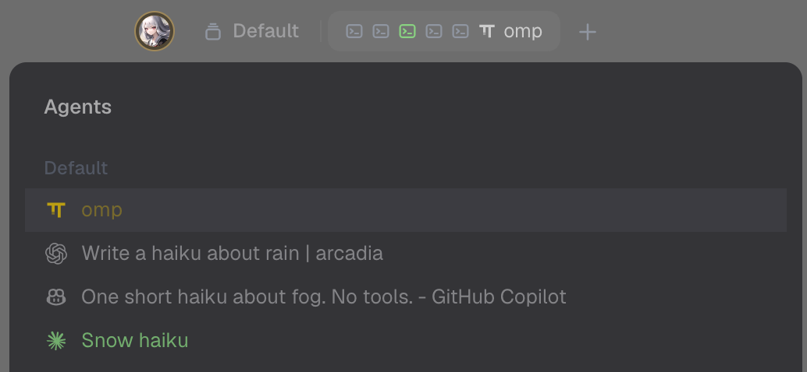

# Tern Agent Navigations

A compact navigator panel for [Tern](https://stencil.so/tern) showing agents grouped by **Tern Session → Agent Session**. Each agent is represented by a single row featuring its harness logo and session title, clickable to focus.



## Usage

- **Ctrl+Alt+N** or command palette `Agent Nav: Toggle`: Open or close the navigator panel.
- Command palette `Agent Nav: Toggle left / right`: Toggle panel attachment between the left and right window edge.
- Command palette `Agent Nav: Reset Width`: Reset panel width to the default ratio (20% of the active tab width).
- Click any agent row: Immediately switches to that agent's Tern session and focuses its pane.

## Behavior & Design

- **Single panel per window, follows active tab**: Following the architecture of Overseer's Projects panel, the window keeps exactly one canvas instance. When switching tabs or sessions, the panel moves into the active tab as a full-height rail on the designated edge. The target tab's existing split hierarchy and ratios are cleanly preserved.
- **Proportional fixed width**: Dragging the divider updates the remembered share ratio (`agent_nav.share`), which travels across tabs and scales smoothly with window resizing.
- **Titles and harness**: each row shows the agent's pane title (omp, Codex and Copilot write their session title there). The harness logo comes from the pane's foreground program, so Codex and Copilot are recognised even when their title does not name them.
- **Row states** (all colors are Tern theme variables, so they follow light/dark mode and the chosen color theme): running — warning color with Tern's native text shimmer; waiting for input — purple; finished and unread — green; error — red; read — secondary text. Tern session names are shown as written, fainter than agent titles.
- **State sources and precedence**: authoritative agent-block state (omp and wrapped chat agents) is trusted when it reports working or waiting_input; an idle/exited report is cross-checked before it is believed — against the pane title's spinner frames (leading or trailing braille), the busy/prompt pair, and the pane's last eight visible screen rows. A stale report (ACP-wrapped panes have reported idle through a real turn) therefore cannot mask real activity. Matching uses the observed English UI text of Copilot, Codex and Claude Code; when those agents change their interfaces the hint tables in `window.luau` need updating.
- **Hook budget**: screen reads are cached per pane and staggered (at most two fresh reads per render, refreshed on cheap-signal change or after a few ticks), and the split-ratio restoration after a tab switch is spread across ticks. A full steering loop inside one hook exceeded Tern's 50 ms plugin budget, after which Tern disables the hook until reload and the panel freezes on stale state.
- **Safe lifecycle**: Explicitly closing the panel disables the feature; if the containing tab or session is closed, the panel automatically restores in the remaining active tab.
- Persisted configuration keys: `agent_nav.enabled`, `agent_nav.side`, `agent_nav.share`.

## Known Limitations

- **Upstream pane-id truncation** ([stencil-hq/tern-sdk#30](https://github.com/stencil-hq/tern-sdk/issues/30)): on a long-lived daemon that has created many tabs, new tab ids exceed the window API's 44-bit range, so the panel cannot move into those tabs and shows an explicit error instead. Status display keeps working; only move/resize of the affected tab is disabled.
- **Screen-hint matching**: status detection for terminal agents matches the observed English UI text of Copilot, Codex and Claude Code (see the hint tables in `window.luau`). A localized or reworded agent interface can hide a running or waiting state until the hints are updated.
- A Copilot pane whose monthly quota is exhausted shows as a plain finished row; it is not misreported as running.

## Development

- `tests/smoke.py` — blackbox end-to-end regression against a running Tern window.
- `.agents/skills/verify-tern-agent-nav/` — live verification harness (launch/doctor/drive/evidence) with the feature map under `features/`.

## Installation

```sh
tern plugin install /path/to/tern-agent-nav --force
tern plugin reload
```

## License

[MIT](LICENSE)
